# 🐝 Mi&Bee Studio

> **技术赋能生活，专业成就无忧**
> *Technology empowers life; professionalism brings peace of mind.*

专注**软件开发、AI 应用、物联网、云原生、可观测性与系统集成**，以全栈技术能力为企业与个人解决实际问题。
We focus on **software development, AI applications, IoT, cloud-native, observability, and system integration** — solving real-world problems for businesses and individuals with full-stack engineering.

---

## 🗺 产品矩阵 · Product Matrix

  

**一张图看懂生态全景** · The whole ecosystem at a glance:

- **三列主线** · 终端设备（ESP32 相机固件 / [MiBee Eye](https://github.com/xiqing85/mibee-eye-rs) 相机家族）→ 协议库（ONVIF · GB/T 28181，Go / Rust / C 三语言实现）→ 平台服务（[MiBeeNvr](https://github.com/Mi-Bee-Studio/MiBeeNvr) / [MiBeeSteward](https://github.com/Mi-Bee-Studio/MiBeeSteward)）· *Devices → protocol libraries → platform, left to right.*
- **四种关系边** · `dep` 代码依赖（逐条经 go.mod / Cargo.toml 核实，如 MiBeeNvr → onvif-go + gb28181-go）· `stream` 视频取流（RTSP · ONVIF · GB28181）· `docs` 文档与门户 · `lineage` 同源派生.
- **仅公开仓库** · Public-only：图中收录 3 个账号共 **34** 个公开仓库（含 [@xiqing85](https://github.com/xiqing85) 的 MiBee Eye 家族与 [@mickeyzzc](https://github.com/mickeyzzc) 的协议库），私有仓库一律不出现.
- 图中为空间所用的简称均可通过下方精选项目表或[组织公开仓库列表](https://github.com/orgs/Mi-Bee-Studio/repositories?type=public)直达原仓库.

## ⭐ 精选项目 · Featured Projects

| 项目 · Project | 简介 · Description |
| --- | --- |
| **[MiBeeNvr](https://github.com/Mi-Bee-Studio/MiBeeNvr)** | Go 轻量级 NVR，支持 RTSP / ONVIF / GB28181 / WebRTC / HLS / RTMP / SRT，浏览器端 AI 检测 · Lightweight self-hosted NVR in Go — single binary, zero dependencies, runs on low-power ARM |
| **[MiBeeSteward](https://github.com/Mi-Bee-Studio/MiBeeSteward)** | 设备管理与监控系统，SNMP/ICMP/HTTP 探测 + Prometheus 指标 · Device management & monitoring — single-binary Go backend with embedded SvelteKit SPA |
| **协议库家族 · Protocol Libraries** [gb28181-go](https://github.com/mickeyzzc/gb28181-go) · [gb28181-rs](https://github.com/mickeyzzc/gb28181-rs) · [onvif-go](https://github.com/mickeyzzc/onvif-go) · [onvif-rs](https://github.com/mickeyzzc/onvif-rs) · [onvif-c](https://github.com/mickeyzzc/onvif-c) | GB/T 28181 与 ONVIF 协议库（Go / Rust / C）：MiBeeNvr 与 MiBee Eye 共同的协议底座 · The protocol foundation beneath MiBeeNvr & MiBee Eye |
| **[esp32s3-n16r8](https://github.com/Mi-Bee-Studio/esp32s3-n16r8)** | MiBee Cam 主力固件：OV3660 3MP + 人脸/移动/二维码 AI 检测、RTSP、ONVIF · Flagship MiBee Cam firmware: MJPEG streaming, face/motion/QR AI detection |
| **[ai-thinker-esp32-cam](https://github.com/Mi-Bee-Studio/ai-thinker-esp32-cam) / [luatos-esp32s3-a10-camera](https://github.com/Mi-Bee-Studio/luatos-esp32s3-a10-camera) / [seeed-esp32s3-cam](https://github.com/Mi-Bee-Studio/seeed-esp32s3-cam)** | 多平台 ESP32 相机固件系列：MJPEG 实时流、移动侦测、OTA、NAS 自动上传 · Multi-board ESP32 camera firmware series — MJPEG streaming, motion detection, OTA & NAS upload |
| **MiBee Eye 相机家族** [mibee-eye-rs](https://github.com/xiqing85/mibee-eye-rs) · [mibee-eye-go](https://github.com/xiqing85/mibee-eye-go) · [mibee-eye-notebook](https://github.com/xiqing85/mibee-eye-notebook) · [mibee-eye-webui](https://github.com/xiqing85/mibee-eye-webui) | 开源相机家族：把 Linux 板子/PC 变成 ONVIF/GB28181 摄像机，Rust/Go 双实现 + PC 采集 + 统一 WebUI（xiqing85 维护）· Open camera family: ONVIF/GB28181 cameras from any Linux board or PC |
| **[mibee-fingerprints-go](https://github.com/Mi-Bee-Studio/mibee-fingerprints-go)** | MiBee 指纹库参考引擎，实现 MiBeeSteward 指纹规范 · Reference Go engine implementing the MiBeeSteward fingerprint spec |
| **[wfp-device-sdk](https://github.com/mickeyzzc/wfp-device-sdk)**（原 esp32-blackbox） | 网络探测设备，兼容 Prometheus Blackbox Exporter，与 [luatos-esp32c3](https://github.com/Mi-Bee-Studio/luatos-esp32c3) 的 blackbox 项目同源 · Network probing device compatible with blackbox_exporter |
| **开发板实验 · Board Labs** [esp32-c3-mini](https://github.com/Mi-Bee-Studio/esp32-c3-mini) · [esp32-s2-mini](https://github.com/Mi-Bee-Studio/esp32-s2-mini) · [esp32-s3-zero](https://github.com/Mi-Bee-Studio/esp32-s3-zero) · [luatos-esp32c3](https://github.com/Mi-Bee-Studio/luatos-esp32c3) · [rp2040-zero](https://github.com/Mi-Bee-Studio/rp2040-zero) · [seeed-xiao-esp32c5](https://github.com/Mi-Bee-Studio/seeed-xiao-esp32c5) / [c6](https://github.com/Mi-Bee-Studio/seeed-xiao-esp32c6) / [rp2350](https://github.com/Mi-Bee-Studio/seeed-xiao-rp2350) | 8 块开发板的基线固件与环境站实验：web OTA、双槽升级、WiFi CSI、双语文档与 CI · Baseline firmware & env-station experiments across 8 boards, bilingual docs, CI builds |

## 📌 核心能力 · Core Capabilities

- **全栈开发与定制化软件服务** · Full-stack development & custom software services
- **AI 应用开发与技术咨询** · AI application development & technical consulting
- **物联网设备接入、数据采集与云端可视化** · IoT device onboarding, data collection & cloud visualization
- **云原生架构设计、容器化与 K8s 运维** · Cloud-native architecture, containerization & Kubernetes operations
- **企业级监控平台搭建（千亿指标规模）** · Enterprise monitoring platforms at billion-metrics-per-day scale
- **嵌入式开发与智能控制系统集成** · Embedded development & smart control system integration
- **信息安全、系统运维与 IT 技术咨询** · Information security, system operations & IT consulting

## 🛠 技术栈 · Tech Stack

### 编程语言 · Languages

### 嵌入式与协议 · Embedded & Protocols

### 云原生 & 可观测性 · Cloud Native & Observability

## ✨ 技术亮点 · Highlights

- 精通 **Shell / Python / Go / Rust / C** 全栈开发 · Proficient across the full stack
- 搭建**日千亿指标**跨地域混合云监控平台，持有 **4 项技术专利** · Built multi-region hybrid-cloud monitoring platforms handling billions of metrics per day; holder of 4 technical patents
- 为 **Thanos、kube-state-metrics、DeepFlow** 等开源社区贡献代码 · Active contributor to Thanos, kube-state-metrics, DeepFlow and other OSS communities
- **KubeSphere 认证讲师**，长期技术分享与社区布道 · KubeSphere Certified Instructor, active in tech sharing & community evangelism
- 10+ 年 IT 运维、开发、云原生全链路经验 · 10+ years of experience across IT operations, development, and cloud-native

## 📊 业务数据 · By the Numbers

- 🌐 **120+** 在线物联网设备 · Online IoT devices
- 🏠 **10+** 智慧家庭解决方案 · Smart-home solutions delivered
- 📈 **72.8%** 服务可用率 · Service availability
- ⚡ **<26ms** 平均响应延迟 · Average response latency

## 🐝 名字的由来 · The Name

**Mi** 取自创始人英文网名 **Mickeyzzc**，**Bee** 来自创始人爱人的网名 —— 两者的组合。
**Mi** comes from our founder's handle **Mickeyzzc**, and **Bee** from his wife's handle.

## 📞 联系我们 · Contact Us

- 🌍 官网 · Website: <https://www.mickeyzzc.tech/>
- 📝 技术博客 · Blog: <https://blog.mickeyzzc.tech/>
- 📧 邮箱 · Email: [mickey_zzc@mickeybee.cn](mailto:mickey_zzc@mickeybee.cn)

---

⭐ 如果我们的项目对你有帮助，欢迎 Star、Fork 与交流！
⭐ If our projects help you, a star is always appreciated — fork them and reach out anytime!
